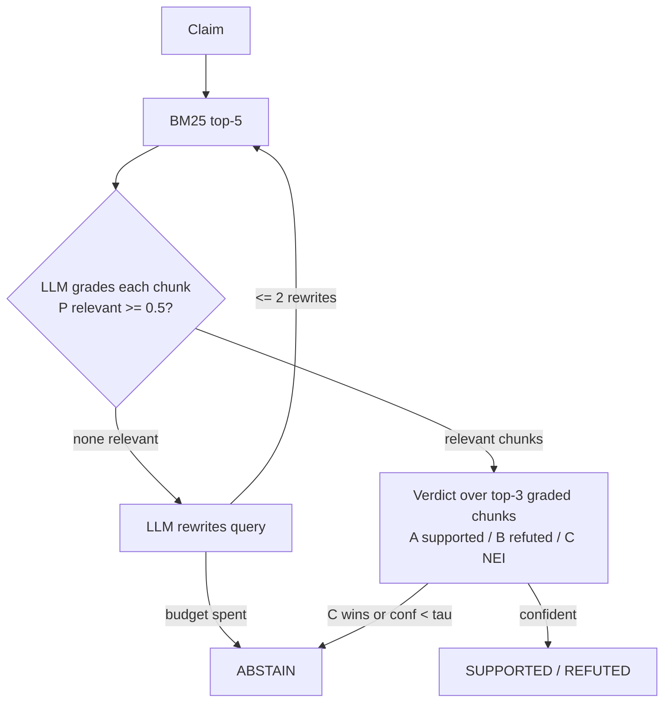

# self-correcting-rag

Agentic RAG that **grades its retrieved chunks, rewrites the query when nothing relevant comes back, retries retrieval, and abstains when confidence is low** — measured against naive RAG on the public SciFact claim-verification benchmark (answer accuracy, abstention rate, false-answer rate).

## What it is
- BM25 retriever over the SciFact corpus (5,183 abstracts).
- A small local LLM (Qwen2.5-1.5B-Instruct, Apple MPS) used as a **grader** (P(relevant) from yes/no logits), **query rewriter** and **verdict model** (A supported / B refuted / C not enough info, from next-token probabilities).
- Three systems on the same retriever and model: `naive`, `naive_nei`, `self_correcting`.

## Why
Naive RAG always answers, so when retrieval misses or the corpus has no evidence it hallucinates a verdict. For SciFact, about a third of claims have **no** evidence in the corpus (NEI) — the right answer there is "I don't know". This repo goes past `braylo-si-rag` and `agent-11-rag-eval-harness` by adding self-correction and abstention, and by scoring wrong answers separately from abstentions.

## Architecture


## How it works
- **Grade:** `P(yes)` vs `P(no)` at the next token for "does this document contain evidence that supports or refutes the claim?". Each doc is graded once, including docs found again after a rewrite.
- **Rewrite:** greedy-generated keyword query (abbreviations expanded, synonyms); the 2nd rewrite is concatenated with the original claim.
- **Abstain:** if no chunk passes the grade threshold after the rewrites, if option C wins, or if `max(pA, pB) / (pA + pB)` is below the answer threshold.
- **Threshold tuning:** the answer threshold is picked on 40 claims from `claims_train` (grid 0.50-0.95, max accuracy). It is never tuned on dev.
- **Scoring:** a claim with gold evidence is correct only if the verdict matches; an NEI claim is correct only if the system abstains. `false_answer_rate` = committed wrong answers / all claims. MIXED-label claims are skipped.

## Results
Measured, from [`results/Qwen2.5-1.5B-Instruct/summary.json`](results/Qwen2.5-1.5B-Instruct/summary.json). The test set is the **first 100 dev claims** (45 SUPPORT, 20 CONTRADICT, 35 NEI). The model is Qwen2.5-1.5B-Instruct in fp16 on MPS. One run took 407 s and 1,188 LLM calls.

| System | Accuracy | Abstention rate | False-answer rate | Precision when answering |
|---|---|---|---|---|
| Naive RAG (always answers) | 0.48 | 0.00 | 0.52 | 0.48 |
| Naive RAG + "not enough info" option | 0.50 | 0.18 | 0.40 | 0.51 |
| **Self-correcting RAG** | **0.61** | 0.48 | **0.16** | **0.69** |

- Self-correcting RAG abstained on 25/35 NEI claims. Naive+NEI abstained on 8/35.
- The rewrite step ran on 20% of claims (mean 0.37 rewrites per claim).
- Tuned answer threshold: 0.95, the top of the grid (train accuracy 0.65).
- **Cost of abstention:** gold evidence was in naive's top 3 for 55/65 evidence claims. It was in self-correcting's kept chunks for only 40/65. The grader drops relevant abstracts, so many of the 48 abstentions fall on answerable claims. (These counts come from `rows.jsonl`.)

## Tests
15 offline tests with a scripted fake LLM (`pytest -q`). They cover tokenizer and BM25 ranking; naive answers and abstains; self-correcting answers, rewrites then finds, abstains after the rewrite budget, grades each doc once, abstains on NEI and on low confidence, and refutes; gold labels; metrics; and re-thresholding.

## Run it
```bash
pip install -r requirements.txt
mkdir -p data && curl -L https://scifact.s3-us-west-2.amazonaws.com/release/latest/data.tar.gz | tar -xz -C data
pytest -q
python -m scripts.run_eval --tune 40 --limit 100      # ~7 min on an M2 Pro (MPS)
```
The SciFact data is not committed. Download it with the command above.

## Limits
- n = 100 dev claims and one model. The confidence interval is wide (about ±0.1 on accuracy). Not run on the full 300 dev claims.
- The tuned threshold sits at the grid edge (0.95). A wider grid might abstain more.
- Retrieval is BM25 only. A dense or hybrid retriever and a cross-encoder grader would probably cut the grader's recall loss.
- The verdict is claim-level (SUPPORT/CONTRADICT/NEI). The SciFact rationale-sentence selection is not done.
- The 1.5B model is a weak verdict model. Precision when answering is 0.69, not production-grade.

## License
MIT
